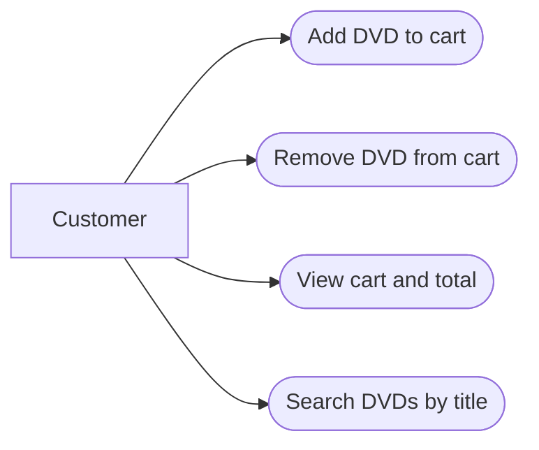

# AIMS-mini: use cases

The cart contains DVDs. Adding/removing updates the cart; viewing lists its contents and total. Title search returns matching DVDs from a supplied collection. Checkout, payment, accounts and persistence are outside this demonstration.
